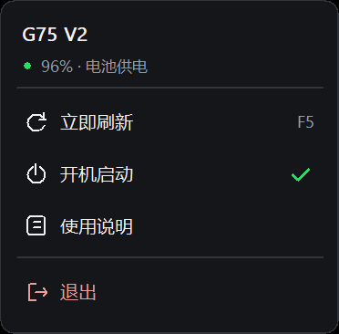

# 迈从键盘电量助手 · MCHOSE Keyboard Battery

直接在 Windows 任务栏托盘查看迈从键盘电量。**本机实测工作集约 14.8 MB，私有内存约 3.1 MB**；原生 C / Win32 实现，不需要常驻迈从 Hub，也不需要安装 .NET、Python 或网页运行环境。

[下载便携版](https://github.com/BochengYao/MCHOSE-Keyboard-Battery/releases) · [兼容性说明](docs/compatibility.md) · [性能测量与方法](docs/performance.md) · [反馈问题](https://github.com/BochengYao/MCHOSE-Keyboard-Battery/issues)

> 当前为多协议预览版。已实机验证 **G75 V2 + 新版 2.4G 接收器（3837:3033）**。其他型号、有线和蓝牙路径已经加入代码，但尚未逐一通过真实设备验证。请勿将本项目理解为“所有迈从键盘、所有固件均已支持”。

## 实际效果

### 电池供电：绿色电量数字


数字直接显示在托盘中，正常电量为绿色，电量不超过 20% 时为红色。鼠标悬停可查看型号、百分比和读取接口。

### 充电：蓝色闪电


部分固件插电后会立即上报“100% + 充电中”，拔线后又恢复原电量。为避免把这个值当成瞬间充满，充电期间统一显示蓝色闪电，不显示充电百分比；拔线后收到有效读数即恢复数字。

### 右键菜单



菜单包含状态、立即刷新、开机启动、使用说明和退出。支持上下箭头、Enter、Esc、F5，以及随屏幕 DPI 调整字体、留白和点击区域。菜单截图是早期实机界面，读数仅代表截图时的设备状态。

## 下载后直接使用

1. 到 **[Releases](https://github.com/BochengYao/MCHOSE-Keyboard-Battery/releases)** 下载 `MCHOSE-Keyboard-Battery-…-windows-x64.zip`。
2. 使用 Windows 的“全部解压”，放到准备长期保留的文件夹。
3. 双击 `G75Battery.exe`。程序只显示托盘图标，不弹出桌面小窗。
4. 图标如果藏在任务栏右下角的 `^` 内，可拖到常显区域。

**普通用户不需要下载源码或安装编译器。** GitHub 自动生成的 `Source code.zip` 是开发用源码，不是可执行便携包。

运行环境：Windows 10 / 11，x64。项目在 Windows 11 本机实测；Windows 10 尚未单独实机验证。暂不提供原生 ARM64 / x86 包。便携包无需管理员权限，默认不修改启动项。

当前发布文件没有数字签名，Windows 可能显示来源或 SmartScreen 提示。请从本仓库 Releases 下载，并用随包 `SHA256SUMS.txt` 或 Release 附件校验文件；也可从源码自行构建。不需要关闭系统防护。

## 功能

- **托盘电量**：绿色数字 / 低电量红色数字 / 充电蓝色闪电 / 无读数灰色问号。
- **低电量提醒**：不超过 20% 且未充电时提醒，限制重复通知；蓝牙缓存不触发低电量通知。
- **30 秒自动刷新**：左键托盘或菜单“立即刷新”可提前查询。
- **可选开机启动**：右键勾选后，仅在当前 Windows 用户登录时启动，不创建系统服务。
- **DPI 适配**：内置 16、20、24、28、32、40、48、64 像素图标；菜单随所在显示器缩放。
- **多协议入口**：新款 CZ、QHW、旧款接收器、旧款 USB，以及 Windows 蓝牙电量缓存。
- **离线工作**：应用不联网，不上传设备信息，也不依赖官方 Hub 进程。

移动文件夹前先取消“开机启动”，移动后运行新位置的程序再重新勾选。文件名暂保留 `G75Battery.exe`，便于早期版本更新及已有启动项沿用。

## 低内存：具体是多少，怎么测的

以下是同一台 Windows 电脑的短时实测，不是所有机器上的固定承诺。每组采样约 36 秒，覆盖一次 30 秒电量查询；新版采样前已使用右键菜单。

| 指标 | 早期 .NET / WinForms 版 | 当前多协议原生版 |
|---|---:|---:|
| 工作集（Working Set） | 69.88–70.23 MB | **14.78–14.79 MB** |
| 私有内存峰值（Private Bytes） | 33.20 MB | **3.05 MB** |
| 采样时长 | 36.4 秒 | 36.5 秒 |
| CPU 时间增量 | 15.62 ms | **0 ms（低于本次计数器精度）** |
| 整机平均 CPU，20 个逻辑处理器 | 约 0.0021% | 本次采样未测得可分辨增量 |
| 线程数 | 28 | 4 |
| 新版句柄范围 | — | 183–183 |

按约 70 MB → 14.8 MB 计算，**工作集降低约 79%**；私有内存从 33.2 MB → 3.05 MB，降低约 **91%**。这里的 MB 以 PowerShell `1MB`（1,048,576 字节）换算，实际为 MiB 口径。工作集包含驻留的共享系统页，不能与私有内存相加，也不等于独占物理内存。

低占用来自实现方式：

1. 去掉 .NET 和 WinForms，直接调用 Windows 原生 API。
2. 图标预先生成、编译进 EXE；运行时按需切换，不加载持续运行的图形或网页引擎。
3. 菜单打开时才创建，关闭后释放窗口、字体和绘图对象。
4. 复用已验证的设备接口，状态不变时不重复更新图标、不反复写日志。
5. 蓝牙只在没有有效 USB / HID 读数时尝试，需要时才加载对应系统 DLL。

没有通过强制清空工作集制造低占用，也没有为了压低数据取消 30 秒查询。实际内存和 CPU 会受 Windows 版本、系统字体、蓝牙驱动、设备数量和运行时间影响。详细原始采样及验证范围见 [performance.md](docs/performance.md)。

## 兼容范围

| 路径 | 型号 / 条件 | 连接 | 当前验证等级 |
|---|---|---|---|
| CZ | G75 V2、G87 V2、K87S、K99 V3 的已知接口 | 2.4G / USB | **G75 V2 2.4G 已实测**，其余待实测 |
| QHW | G87 V3、G98 V3、K87 V3 的已知接口 | 2.4G / USB | 已实现并通过帧测试，待实测 |
| 旧款 V1 | 官方表中 18 个型号密码，确认身份后读取 | 2.4G | 已实现并通过帧测试，待实测 |
| 旧款 USB | 已知系列 + 对应报告接口 | USB | 预览实现，待实测 |
| Windows / 标准 BLE | 已知 MCHOSE 键盘系列，系统能提供电量缓存 | 蓝牙 | 已实现缓存读取，待实机验证 |

旧款型号表包括：G87、K99、K99 V2、G98、X75、G98 Pro、X75 V2、G75 Pro、G98 V2、UT98、Z75、Z75S、KX75、GX87、GX87 V2、K87、G75 V2、G87 V2。

重要边界：

- 设备名相同不代表协议相同，硬件批次、固件和接收器版本都可能影响结果。
- 蓝牙明确标注为 **系统缓存，连接和充电状态未确认**；缓存为空就不显示百分比，不主动连接或唤醒设备。
- 2.4G 接收器也可能返回键盘休眠前的快照；有应答不等于电量刚刚更新。
- 无电池的纯有线键盘没有电池百分比；“USB 有线接口”也不用于断言当前按键输入路径。
- 同时连接多把键盘时，目前只显示优先可读取的一个，不提供多个托盘图标。
- 本项目不是迈从官方软件，不提供刷固件、改键、宏或灯效控制。

协议入口、PID、缓存语义及未验证项详见 [compatibility.md](docs/compatibility.md)。

## 读不到电量

先按几下键盘唤醒，然后左键托盘或右键“立即刷新”。如果仍没有读数，关闭官方 Hub、断开网页驱动连接，必要时重插接收器。设备变化或手动刷新会重扫接口，后台每五分钟也会补扫。

仍不支持时，可在解压目录运行：

```powershell
.\G75Battery.exe --inventory
.\G75Battery.exe --probe
# 蓝牙问题可单独尝试：
.\G75Battery.exe --bluetooth-probe
```

`--inventory` 只枚举已识别的 HID 接口，不发送设备命令。它不输出设备路径、序列号或蓝牙地址。`--probe` 输出一次电量诊断；`--bluetooth-probe` 只尝试 Windows 电量属性和标准 GATT 缓存。

提交 Issue 时请写明键盘完整型号、接收器版本、固件版本（如知道）、连接方式，以及 Hub 是否能显示电量，并检查后附上 `device-inventory.txt` / `probe-result.txt`。不要将“未测试”当作“肯定支持”。

## 从源码构建

普通用户直接下载 Release 即可。开发者可选：

```powershell
# Visual Studio C++ Build Tools + Windows SDK，脚本自动寻找环境
.\scripts\build.ps1 -Toolchain MSVC

# 或使用 MinGW-w64（工具目录可自行指定）
.\scripts\build.ps1 -Toolchain MinGW -MinGWBin C:\mingw64\bin

.\scripts\package.ps1
```

生成 `build/G75Battery.exe`，便携包位于 `dist/`。源码中的 `--self-test` 验证协议帧、型号过滤、状态规则、蓝牙 ABI 和图标资源，不能替代真实键盘测试。GitHub Actions 会在 Windows 环境构建并运行离线测试。

## 实现与许可

运行时只调用 Windows 系统 DLL。读取 HID 信息后，会核对厂商、型号、Usage、报告 ID 和长度；共享接收器需进一步确认型号。应用只发送已知的读取 / 会话查询，不执行配置、灯效、宏和固件写入。最近读取记录仅在显示状态变化时更新。

协议事实来自 [迈从官方 M HUB WEB](https://www.mchose.com.cn/) 和 Microsoft Bluetooth GATT 文档；没有打包官方前端或驱动。图标为本项目生成的数字和状态图形。源代码采用 [MIT License](LICENSE)。

English: A small native Win32 tray utility for MCHOSE keyboard battery status. Download the Windows x64 ZIP from Releases, extract it, and run `G75Battery.exe`. Current measured working set is about 14.8 MiB on one Windows PC. Only G75 V2 with its newer 2.4 GHz receiver is hardware-verified; other protocol paths are experimental, and Bluetooth readings are explicitly labeled as OS-cached data.
